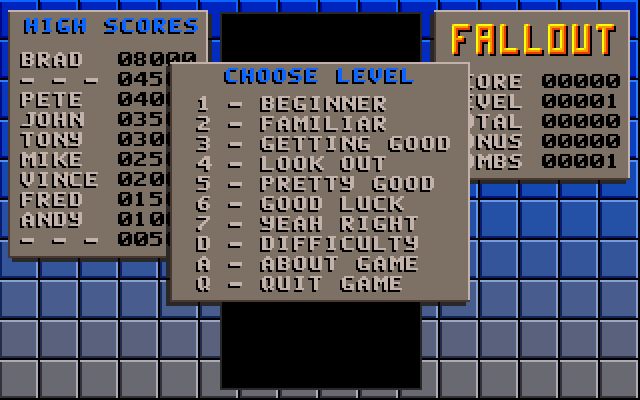
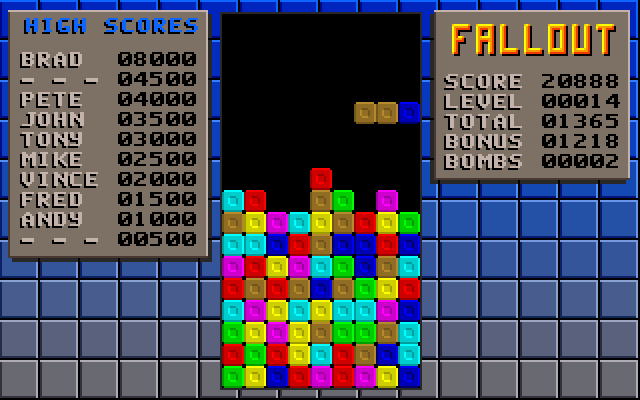
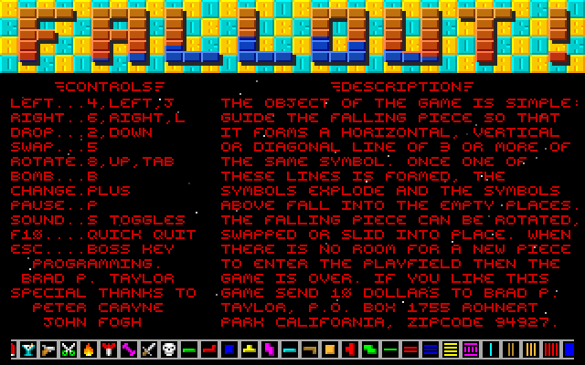
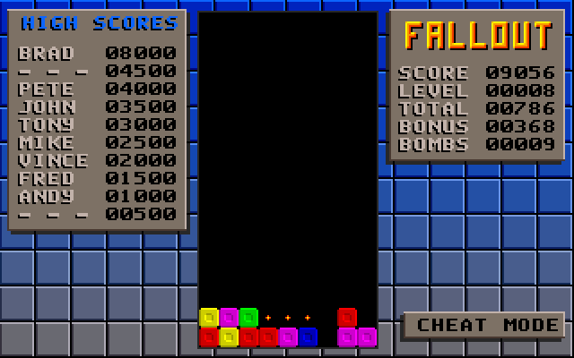

# FallOut (1991) — reconstructed C source

`FALLOUT.EXE` is a VGA (320×200, mode 13h) falling-symbols puzzle game for DOS,
written by Brad P. Taylor in 1991. The original source was not available. This
repository holds C source recovered from the executable, plus the tools used to
recover it and to **prove the result behaves identically to the original**.

| | |
|---|---|
|  |  |
|  |  |

*Screenshots rendered by the reconstructed C code (native test build).*

## What's here

```
FALLOUT.EXE          the original (LZEXE 0.91 packed), untouched
src/fallout.c        the game: 87 functions, in original order, with original offsets
src/gfx.c, gfx.h     C versions of the original's hand-written assembly module
src/data/*.inc       sprites, palette, fonts, tables extracted from the EXE (generated)
tests/*.keys         key scripts used for differential testing
tests/his/           FALLOUT.HIS fixtures for the high-score file tests
tools/               unpacker, analysis scripts, data generator, test harnesses
ports/sdl/           modern port (in progress), built from the unmodified sources
docs/                screenshots and an asset sheet (docs/assets.png)
```

## Building the DOS game

The source targets **Turbo C++ 1.0** (1990), small memory model — the compiler
the original was built with (identified from its C0 startup code and runtime
library). Turbo C++ 1.01 should work too. In DOS (or DOSBox):

```
cd src
tcc -ms fallout.c gfx.c
```

`gfx.c` uses Turbo C pseudo-registers (`_AX`, …) and `geninterrupt()` for the
BIOS/DOS calls, so it is Turbo/Borland C specific. The original was additionally
compressed with LZEXE; that step is optional.

The reconstruction has not been compiled with Turbo C++ yet; see
*Limitations* below.

## How the source was recovered

1. **Unpacking.** `tools/unlzexe.py` decompresses the LZEXE 0.91 image
   (62,170-byte load module, 3 relocations).
2. **Identifying the pieces.** The startup code is Borland's `C0S` (small model),
   followed by three regions:
   * `0x0239–0x43AD` — the C game module (87 functions);
   * `0x43AE–0x5FE3` — a hand-written assembly module (blitters with fully
     unrolled 200-row loops, board match/collapse logic, BIOS/DOS wrappers);
   * `0x5FE4–` — the Turbo C++ runtime library (`rand`, `sprintf`, `delay`,
     `sound`, `system`, long-arithmetic helpers, …).
3. **Decompilation.** Ghidra 12 (headless, `tools/Annotate.java` +
   `tools/annotations.txt`) produced a first draft once it was given the
   library names, the register-argument helpers (`N_LXMUL@` etc.) and overrides
   for Turbo C's sparse `switch` tables (`tools/find_switches.py`). Every
   function was then rewritten by hand against an annotated disassembly
   (`tools/listing.py`). The draft decompiler output was wrong in several
   places, e.g. register tracking in `trans_bands` and dropped `switch` cases.
4. **Data.** Every DGROUP object was located from code and pointer references
   (`tools/dsrefs.py`). `tools/gen_data.py` writes the graphics and tables as C
   initialisers (`src/data/*.inc`); `docs/assets.png` shows them all.
5. **Layout.** Turbo C emits initialised globals where they are defined and a
   function's string literals right after that function, so the order of
   strings and variables in the data segment reveals the original source order.
   `fallout.c` places its definitions to reproduce the original data segment
   offset-for-offset (comments give each object's `DS:` offset). Unreferenced
   variables are kept as `unused_xxxx`.

## Verification: differential emulation

The C code is not trusted on inspection alone. It was **run side by side with the
original binary** and compared frame by frame:

* `tools/emu/run_original.py` runs the *original* unpacked EXE in the Unicorn
  8086 emulator with a small, deterministic BIOS/DOS. Time is "number of BIOS
  tick reads", and keys come from a script.
* `tools/emu/harness.c` compiles the *reconstructed* `fallout.c` + `gfx.c`
  natively against the same model, using a flat 1 MB array for far memory.
* At **every** read of the BIOS clock and every `delay()` call, both write
  the CRC of the whole VGA frame buffer plus score/level/bonus/total to a
  trace. (The end-of-game tally runs on `delay()` alone, without reading the
  clock.) The traces must be identical, including every keypress, every
  `sound()`/`nosound()` call, video-mode change, DOS message and the exit
  code.

Test inputs (`tests/`) include random key fuzzing, scripted play at every
difficulty and start level, menus, cheat mode, pause, the boss key, high-score
entry and saving, quitting from every screen, and start-up failures (no VGA, out
of memory). Three scripts start with a `FALLOUT.HIS` present (`# ENV=HIS_FILE=`,
fixtures from `tests/his/mkhis.py`): a full table and a truncated one, each
loaded, beaten and saved, and one quit without saving. Every byte the game
writes to the file is compared too. They also include several long games played by a bot
(`tools/emu/bot.py`) that steers the original game from its memory; its
keystrokes are recorded and replayed on both sides. The bot games reach
level 200+ and scores in the millions; one (`bot_wrap`, recorded with
`run_original.py --lose-at-level 182`) loses on purpose at level 182 so that
the end-of-game tally wraps the 16-bit bonus.

**Result: all 35 scripts produce identical traces — about 1,050,000 frames
at clock reads plus 125,000 at `delay()` calls and 255,000 speaker calls
compared, with zero differences.** Source-line coverage of `fallout.c` over the
suite is 98.4%. The lines not reached are `break`s after `exit()`, code the
original can never execute, and the "slow machine" and midnight-wraparound
guards, which a deterministic clock cannot trigger.

To run it yourself (needs `pip install unicorn`, a C compiler and zlib;
set `PYTHON=` to use a virtualenv's interpreter):

```
tools/emu/run_all.sh                 # every script, prints MATCH/DIFFER
tools/emu/difftest.sh tests/fuzz1.keys
tools/emu/coverage.sh tests/*.keys   # clang source coverage
```

The native build compiles a copy of `fallout.c` derived by
`tools/emu/mkport.py`, and the SDL port uses the same copy:

* The uninitialised globals are packed into one struct in their original order
  (`tools/emu/mkbss.py`). The original reads past the end of `board[]` in one
  case (see below), and this keeps those reads hitting the same neighbouring
  data.
* Three expressions are patched to wrap at 16 bits as Turbo C's `int` does.
  The one that matters in play is `bonus`: the end-of-game tally adds up to
  1000 per level, so at high levels the original's bonus wraps past 65535
  (`tests/bot_wrap.keys`). `MKPORT_FLAGS=--no-int16` builds without the
  patches.
* `struct hiscore` is packed into its DOS layout (8-byte name, 32-bit score,
  16-bit slot), so the table in memory is the 140-byte `FALLOUT.HIS`, as on
  DOS. A name with no NUL is drawn on into its score bytes, as the original
  does (`tests/t_his_load.keys`).

## Things the original does that you might not expect

These are reproduced faithfully in the source and commented there.

* **Off-board read when rotating.** Rotating a horizontal piece on the bottom
  row tests `board[17][col]`, one row past the array. That byte is
  `shell_cmd[4]`, the `E` of the default boss-key command `PAUSE`, so the
  rotation is refused. With a boss-key command of four characters or fewer,
  the piece would rotate off the board.
* **Bomb placement** tries nine random columns and keeps the last. The bomb is
  armed if *any* try landed below row 5. Columns are chosen with
  `rand() * 6 / 32767`, so bombs only ever appear in the left six columns. A bomb spawns on about 1 in 200
  pieces, or 1 in 10 in cheat mode. Kind 0 gives you an extra bomb; kind 1
  detonates at once for +500.
* **A bomb** removes every symbol of the most common kind on the board.
* **Difficulty menu:** after a choice, the highlight is moved 20 pixels too low.
  It is redrawn immediately afterwards, so this is barely visible.
* `draw_panel()` takes five parameters, but every caller passes a sixth (a
  colour) that it ignores. No prototype was in scope.
* The level menu has no starting level 2 (`3` starts level 3), so the
  "level 2 → 1 bomb" branch can never run.
* `get_pixel()` returns a 16-bit word, so title-screen stars are drawn only
  where *two* adjacent pixels are black. `copy_rect()` copies whole words.
* Assembly routines that are never called: a "recolour" fill that clobbers `BP`
  and compares each pixel with itself, plus hardware-scroll and split-screen
  helpers. `set_small_color2()` is never called either.
* `vga_present()` calls INT 10h/1A00h, ignores the result, and returns the
  BIOS byte at `0040:008A` instead.
* Undocumented keys:
  * `A` in game abandons the current game.
  * `V` increments a variable that nothing reads.
  * `F1` on the title screen adds stars.
  * `B` in the difficulty menu turns on **cheat mode**, which makes bombs
    frequent and disables high scores.
* `FALLOUT.HIS` is the 140-byte high-score table XORed with 2, 4, 6, …
  (a byte, so the key wraps after 127 bytes). It is saved only when quitting
  with `Q` from the main menu; F10 never saves. A short file leaves the rest of
  the default table in memory, and that gets scrambled along with the file.
* Score arithmetic is 16-bit (`n * multiplier / 2`), as in the original, and
  so is `bonus`: a game ending at a high enough level wraps it during the
  end-of-game tally, losing 65536 points.

## Limitations / possible next steps

* **Not yet compiled with Turbo C++.** The goal was behavioural equivalence,
  which is what the tests prove. Rebuilding with Turbo C++ 1.0/1.01 in DOSBox
  would be the next check, both that it compiles and how close the machine code
  is. Exact matches would also need the original's local-variable declaration
  order and similar details.
* The assembly module is provided as C. Its behaviour is preserved, but its
  unrolled-loop speed is not.
* A modern SDL port is in `ports/sdl/` (see its README): playable, with sound
  and high scores. It compiles the unmodified sources against a DOS stand-in
  layer, and its replay mode is checked against the original's traces.
